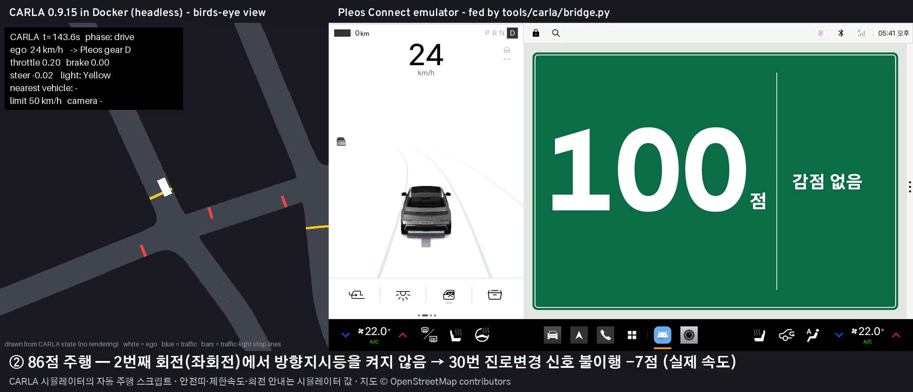

# 운전선생 (DriveTeacher)

> **소개 페이지: https://kyusuncho.github.io/driveteacher/**
> 사용법, 강남운전면허시험장 C코스 리플레이 지도, 100점·86점·51점 주행 영상을 한 페이지에 모았습니다.

**차량 신호로 운전면허 도로주행 시험 채점표(도로교통법 시행규칙 별표26)의 항목 번호와 배점 그대로 운전을 채점하고, 감점이 나는 순간 화면 한 줄과 음성으로 알려 주는 Pleos Connect 운전 연습 앱입니다.**

- 주차 중(P): 시험을 시작하고, 끝나면 합격·불합격·실격과 감점 내역(시각, 항목 번호, 이유)을 봅니다.
- 주행 중: 화면에는 점수와 마지막 감점 한 줄만 나옵니다. Pleos TTS가 "진로변경 신호 불이행, 7점 감점되었습니다."처럼 이미 일어난 일만 말합니다.
- 채점 항목은 차량 신호로 판정할 수 있는 12개와 실격 2개입니다. 정지 중 기어 미중립(4), 급조작·급출발(9), 출발 신호 안함·중지·계속(11~13), 엔진 브레이크 사용 미숙(18), 정지 때 미제동(20), 급브레이크 사용(21), 진로변경 신호 불이행·30미터 전 미신호·미유지·미중지(30~33)를 채점합니다. 실격은 제한속도 시속 10km 초과, 좌석안전띠 미착용입니다.



## APK 위치

**[`apk/kyusuncho_운전선생_release.apk`](apk/kyusuncho_운전선생_release.apk)**

- release 빌드, 버전 0.1.0(versionCode 1), 약 29MB. 패키지 `com.kyusun.driveteacher`.
- minSdk 28, targetSdk 34.

## 테스트 환경

| 항목 | 값 |
|---|---|
| 에뮬레이터 | **Pleos Connect 에뮬레이터 v2.1.0** (AVD `Pleos_Connect_API_34`, Android 14, 빌드 `RELEASE.release_connect_v2.1.0`) |
| 화면 규격 | **2560 × 1440, 160dpi** (가로형) |
| Pleos SDK | Vehicle 2.3.2, NaviHelper 3.0.5, TextToSpeech 3.3.1, FusedLocation 1.1.3 |
| 빌드 | Gradle Wrapper, Android Gradle Plugin 9.1.0, JDK 17 |
| 실제 차량 | 사용하지 않음 |

필요한 설정은 다음과 같습니다.

- 처음 실행할 때 **위치**와 **차속** 권한을 허용합니다. 차속 권한이 없으면 시험을 시작할 수 없습니다.
- 감점 음성은 Pleos TTS의 ON_DEVICE 모드라 클라이언트 ID나 네트워크가 필요 없습니다.
- API 키나 서버는 쓰지 않습니다.

## 실행 방법

1. Pleos Connect 에뮬레이터를 켜고 APK를 설치합니다.
   ```sh
   adb install apk/kyusuncho_운전선생_release.apk
   ```
2. 앱 목록에서 **운전선생**을 열고 권한을 허용합니다.
3. 기어가 P인 상태에서 **도로주행 시험 → 시험 시작**을 누릅니다.
4. Virtual Console로 차를 움직입니다. 예를 들어 왼쪽 방향지시등을 켜지 않고 D로 바꿔 출발하면, 화면에 "출발 신호 안함 −5"가 뜨고 음성이 나옵니다. 1초에 약 11km/h 넘게 감속하면 급브레이크(21, −7)입니다.
5. 다시 P로 세운 뒤 **시험 끝내기**를 누르면 결과 화면이 나옵니다.

### 에뮬레이터에서 채점하지 못하는 항목

에뮬레이터는 일부 차량 값을 주지 않습니다. 이때 앱은 해당 항목으로 감점하지 않고, 결과 화면의 **"채점하지 못한 항목"**에 따로 표시합니다.

- **안전띠:** 에뮬레이터에서는 늘 "미착용"으로 읽히고 콘솔로 바꿀 수 없습니다. 한 번도 "착용"으로 읽히지 않으면 이 항목을 끕니다.
- **제한속도:** NaviHelper가 늘 0을 줍니다.
- **회전 안내:** NaviHelper의 회전 안내는 경로 안내 중인 내장 내비가 줍니다. 이 값이 없으면 회전 방향지시등 항목(30~33)을 채점하지 않습니다.

시연 영상에서는 이 세 값을 CARLA 시뮬레이터가 **debug 빌드에만 있는 시뮬레이터 채널**로 넣었습니다. release APK에는 이 채널이 없습니다.

## 시연 영상

왼쪽은 CARLA 시뮬레이터를 위에서 내려다본 그림, 오른쪽은 Pleos Connect 에뮬레이터에서 도는 운전선생입니다. 강남운전면허시험장 도로주행 C코스를 같은 운전 스크립트로 세 번 달렸습니다.

| 영상 | 내용 |
|---|---|
| [요약 영상 (3분 43초)](assets/experiments/submission/driveteacher-summary.mp4) | 100점 주행과 51점 불합격 주행 전체(10배속), 86점 주행의 첫 감점(실제 속도), 세 결과 화면 비교 |
| [100점 합격 (15분)](assets/experiments/carla-driveteacher-courseC-1115/carla-pleos-demo.mp4) | 7번의 회전 모두 신호. 감점 0건 |
| [86점 합격 (14분 31초)](assets/experiments/carla-driveteacher-courseC-1115-86/carla-pleos-demo.mp4) | 2·6번째 회전에서 신호를 켜지 않음. 30번 진로변경 신호 불이행 2건 |
| [51점 불합격 (15분 11초)](assets/experiments/carla-driveteacher-courseC-1115-51/carla-pleos-demo.mp4) | 7번 모두 신호를 켜지 않음. 같은 항목 7건 |

> 영상 속 주행은 CARLA의 자동 주행 스크립트입니다. 안전띠, 제한속도, 회전 안내는 시뮬레이터 값입니다.

### 시연 재현 (debug 빌드 + CARLA)

Docker Desktop과 Pleos 에뮬레이터를 켠 상태에서 실행합니다.

```sh
./gradlew :app:installDebug
# 앱에서 "도로주행 시험 → 시험 시작"을 누른 뒤
tools/carla/run.sh --driver --course C                         # 강남운전면허시험장 C코스 (A, B, D도 됨)
tools/carla/run.sh --driver --course C --forget-signal 2,6     # 2·6번째 회전에서 신호를 켜지 않음
```

CARLA 0.9.15는 Docker에서 렌더링 없이 돕니다. 브리지(`tools/carla/bridge.py`)는 두 경로로 값을 넣습니다.

- Virtual Console: 차속, 기어, 조향, 방향지시등.
- 에뮬레이터 콘솔: GPS.

## 구조

```
차량 (또는 CARLA → bridge.py → Virtual Console·에뮬레이터 콘솔)
  → 신호 수집 (signal/SignalCollector: Vehicle SDK, AAOS Car API, NaviHelper, FusedLocation)
  → 판정 엔진 (scoring/: RoadTest, Turns, EventDetector, 순수 Kotlin)
  → 화면 한 줄 + Pleos TTS 음성 (MainActivity, Voice, Notice)
  → 결과 리포트
```

채점 규칙은 앱의 판정 엔진 한 곳에만 있습니다. 시뮬레이터 쪽은 무슨 일이 있었는지만 보냅니다.

## 빌드와 테스트

```sh
./gradlew :app:testDebugUnitTest   # 판정 엔진 단위 테스트 (CARLA 주행 녹화 포함)
./gradlew :app:assembleRelease     # release APK
```

release 서명 키는 저장소에 없습니다. `~/.gradle/gradle.properties`에 `driveteacher.storeFile`과 `driveteacher.storePassword`를 두면 서명된 APK가 나오고, 없으면 서명하지 않은 APK가 나옵니다.

## 출처와 라이선스

- 채점 기준: 도로교통법 시행규칙 별표26. 법령은 저작권 보호 대상이 아닙니다(저작권법 제7조).
- 지도: © OpenStreetMap contributors, [ODbL](https://opendatacommons.org/licenses/odbl/) (`tools/carla/maps/`).
- 시험 코스: 강남운전면허시험장 도로주행 A~D 코스가 어느 길과 교차로로 도는지만 지도 위에 점으로 옮겼습니다. 코스도 그림과 안내 영상은 저장소, 앱, 영상에 넣지 않았습니다(`tools/carla/course.py`).
- 단속 카메라 위치: 경찰청 「전국무인교통단속카메라표준데이터」, 공공데이터포털.
- 시뮬레이터: [CARLA](https://carla.org) 0.9.15. 코드는 MIT, 에셋은 CC-BY. Docker 이미지로 실행만 하고 저장소에 넣지 않았습니다.
- 글꼴: Overpass, Gothic A1. 둘 다 SIL Open Font License 1.1이고, 원문은 `app/src/main/assets/fonts/`에 있습니다.
- Pleos SDK: Pleos Playground.

개발 기록은 [PLAN.md](PLAN.md)에 있습니다. 실측 결과, 결정과 그 이유, 남은 일을 적었습니다. 제품 정의는 [PRODUCT.md](PRODUCT.md), 화면 디자인은 [DESIGN.md](DESIGN.md)에 있습니다.
